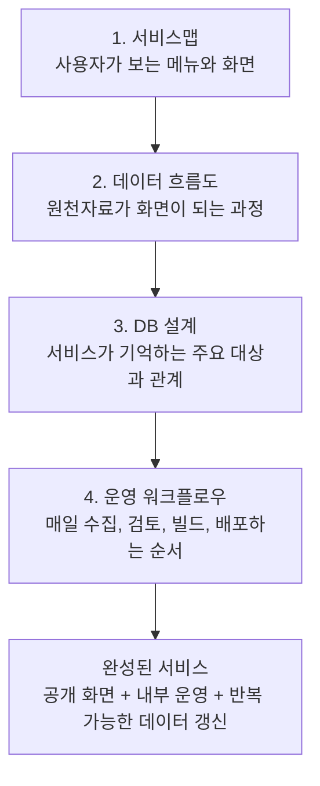
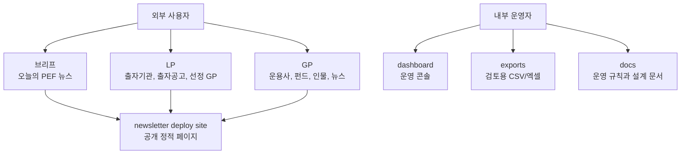
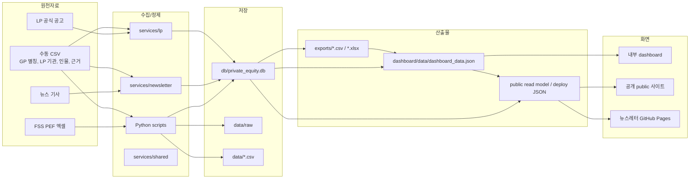
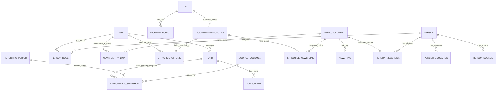
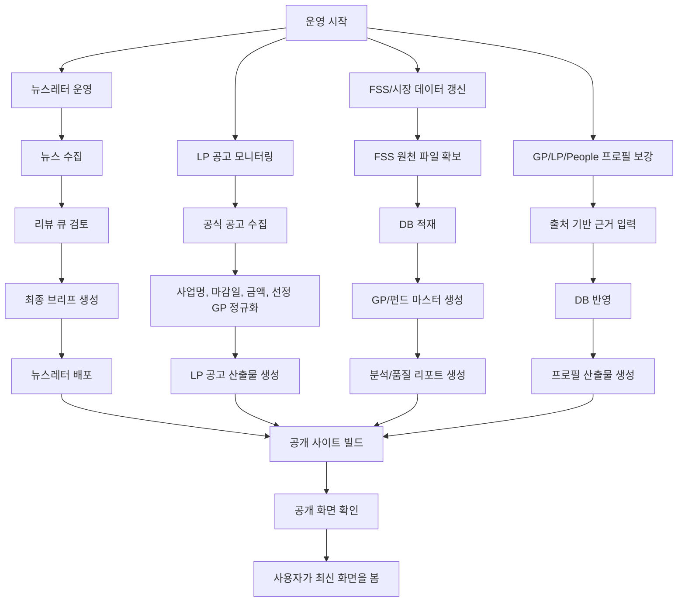
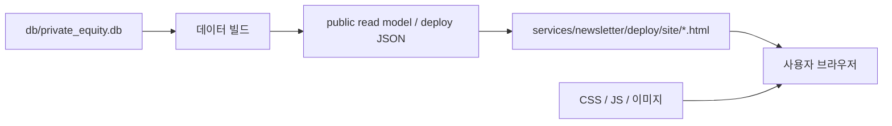
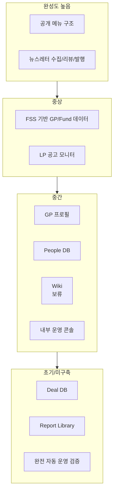
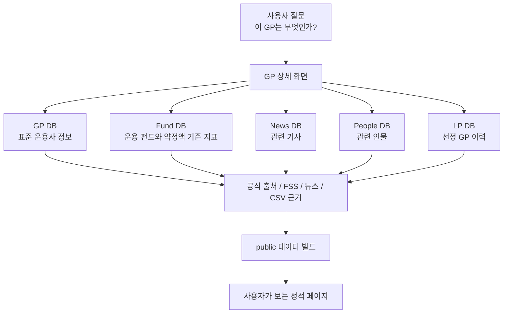
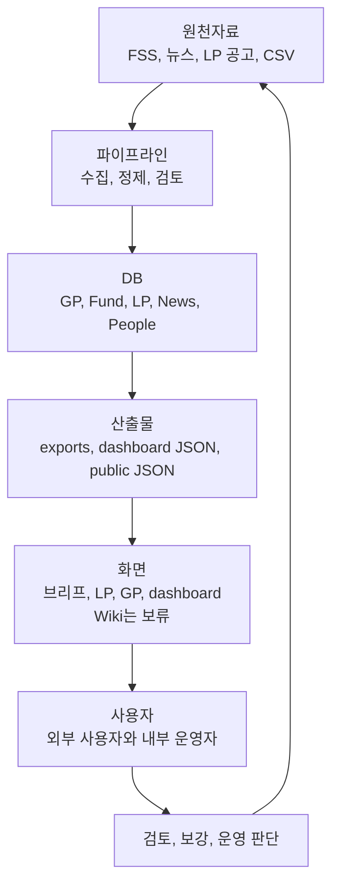

# Korea PEF Intelligence 비전공자용 시스템 도식

작성일: 2026-06-10

이 문서는 `docs/non_developer_system_overview.md`를 그림 중심으로 다시 정리한 것이다.
각 그림은 하나의 레이어를 설명한다.

## 0. 네 개의 레이어가 겹쳐진 서비스



읽는 법:

| 레이어 | 핵심 질문 |
| --- | --- |
| 서비스맵 | 사용자는 어디로 들어가서 무엇을 보는가? |
| 데이터 흐름도 | 데이터는 어디서 들어와서 어디로 나가는가? |
| DB 설계 | 서비스가 무엇을 기억하고 무엇끼리 연결하는가? |
| 운영 워크플로우 | 사람이 어떤 순서로 서비스를 굴리는가? |

## 1. 서비스맵



핵심:

| 구역 | 의미 |
| --- | --- |
| `services/newsletter/deploy/site/` | GitHub Pages로 배포되는 공개 사이트 bundle |
| `services/newsletter/deploy/site/` | GitHub Pages로 배포되는 공개 사이트 bundle |
| `dashboard/` | 내부 운영자가 보는 콘솔 |
| `exports/` | 사람이 검토하는 작업 파일 |

## 2. 데이터 흐름도



핵심:

```text
수집 완료 = 공개 완료가 아니다.
DB 저장, 산출물 생성, 정적 페이지 빌드, 배포까지 끝나야 사용자가 본다.
```

## 3. DB 주요 엔티티 관계도



읽는 법:

| 엔티티 | 쉬운 의미 |
| --- | --- |
| `GP` | PEF 운용사 |
| `FUND` | PEF 펀드 |
| `LP` | 출자기관 |
| `LP_COMMITMENT_NOTICE` | 출자공고, 선정 결과, 변경 공고 |
| `NEWS_DOCUMENT` | 뉴스 기사 |
| `PERSON` | 운용사/기관 관련 인물 |
| `SOURCE_DOCUMENT` | FSS 원천자료 같은 공식 문서 |
| `REPORTING_PERIOD` | 기준 분기 |

핵심:

```text
이 서비스의 가치는 개별 표가 아니라 연결에 있다.
GP가 펀드, 뉴스, 인물, LP 선정 결과와 연결될수록 데이터 상품이 된다.
```

## 4. 운영 워크플로우



핵심:

| 단계 | 의미 |
| --- | --- |
| 수집 | 원천자료를 가져온다 |
| 정제 | 이름, 날짜, 금액, URL을 맞춘다 |
| 검토 | 사람이 포함/제외, 출처, 품질을 확인한다 |
| DB 반영 | 반복 가능한 저장소에 넣는다 |
| 산출물 생성 | CSV, JSON, HTML을 만든다 |
| 빌드 | 공개 화면용 파일을 다시 만든다 |
| 배포 | 사용자가 보는 위치에 올린다 |
| 확인 | 공개 화면에 이상이 없는지 본다 |

## 5. 정적 페이지 관점의 공개 구조



정적 페이지는 "미리 만들어 둔 파일을 사용자가 보는 방식"이다.

```text
DB가 바뀌어도 public 화면이 자동으로 바뀌지 않는다.
service_data.json과 HTML을 다시 만들고 배포해야 화면이 바뀐다.
```

이 서비스는 HTML 파일을 수천 개 만드는 방식보다는, 비교적 적은 HTML과 큰 JSON 데이터를 조합하는 방식에 가깝다.

## 6. 완성도 지도



핵심:

| 상태 | 해석 |
| --- | --- |
| 완성도 높음 | 이미 반복 운영 가능한 핵심 구조가 있음 |
| 중상 | MVP가 있고 품질 보강이 필요함 |
| 중간 | 기반은 있으나 출처, 화면, 연결 품질을 더 쌓아야 함 |
| 초기/미구축 | 장기 제품 가치가 크지만 아직 본격 설계 또는 구현 전 |

## 7. 하나의 예시로 보는 전체 연결

예시 질문:

```text
"MBK파트너스는 어떤 운용사이고, 어떤 펀드와 뉴스, LP 선정 결과가 연결되어 있나?"
```

서비스가 이 질문에 답하는 방식:



이 예시가 이 서비스의 핵심이다.

```text
단순히 GP 이름 하나를 보여주는 것이 아니라,
그 GP와 연결된 펀드, 뉴스, 인물, LP 선정 이력을 하나의 프로필로 묶는 것이 목표다.
```

## 한 장 요약



최종 결론:

```text
이 서비스는 원천자료를 모으는 도구가 아니라,
원천자료를 엔티티와 관계로 바꿔서 반복적으로 공개 가능한 데이터 상품으로 만드는 시스템이다.
```
